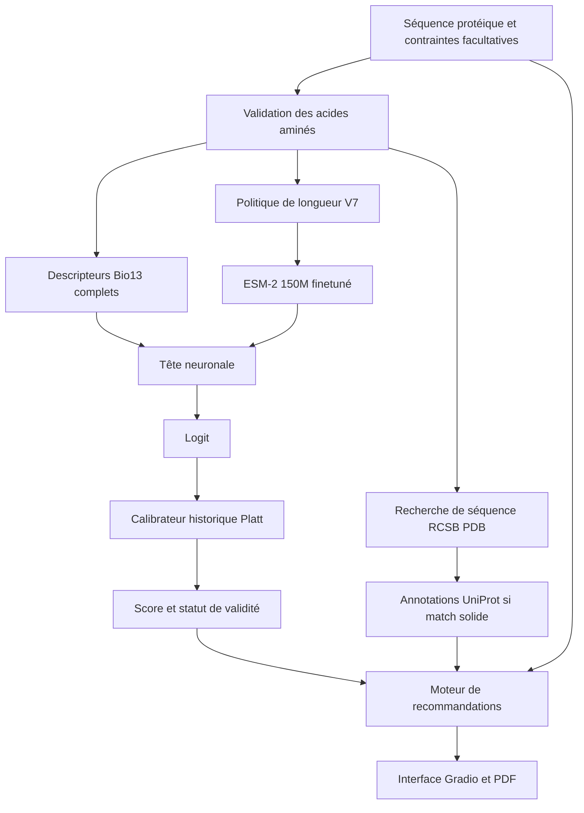

# Architecture de la V7

## Pipeline unique

## Code et responsabilités

| Fichier | Rôle |
|---|---|
| `app.py` | Chargement sécurisé du checkpoint, ZeroGPU, interface, orchestration |
| `solubility/finetune.py` | Fonctions historiques `bio13` et architecture du réseau, nécessaires pour restaurer le checkpoint |
| `solubility/length_policy.py` | Politique de longueur 512 / 1 022 / repli 512 |
| `solubility/workflow.py` | Lien entre le score, l'identification et le plan |
| `solubility/protein_identifier.py` | Appels publics PDB/UniProt, alignements, vérification des annotations |
| `solubility/expert_rules.py` | Règles de priorisation des essais biochimiques |
| `solubility/protein_advice.py` | Présentation des recommandations, caractéristiques de séquence, PDF |
| `tests/test_*.py` | Tests hors GPU / simulés |

## Fichiers modèle non versionnés sur GitHub

- `finetune_best.pt` : paramètres du modèle ESM-2 fine-tuné.
- `platt_calibrator.joblib` : calibrateur historique.
- `finalisation_figee.json` : seuil figé et SHA-256 attendus.

Le code récupère ces artefacts à l'exécution depuis le dépôt Model privé défini par `HF_MODEL_REPO`, avec `HF_TOKEN` en secret de Space. Le checkpoint doit provenir d'une source de confiance : le chargement d'objets Python non fiables est dangereux.

## Longueur et statut scientifique

- ≤512 AA : fenêtre historique entraînée, score calibré selon son protocole interne.
- 513–1 022 AA : utilisation du même checkpoint mais entrée plus longue ; score issu de l'ancien calibrateur **non recalibré pour cette plage**.
- >1 022 AA : seuls les 512 premiers AA sont transmis au réseau ; Bio13 calculé sur toute la séquence et avertissement d'informations ignorées.

Les observations et le PDF doivent refléter la fenêtre réellement analysée. Le moteur de conseils n'utilise **pas** le score transféré 512→1 022 comme indice fiable pour classer tags ou hôtes.

## Confidentialité

L'appel automatique aux bases publiques n'est déclenché qu'après une action explicite « Analyser la séquence ». Il requiert l'autorisation de transmettre la séquence à des tiers ; aucune consultation externe n'est possible hors réseau. Ne pas utiliser ce service pour des séquences confidentielles sans accord.
